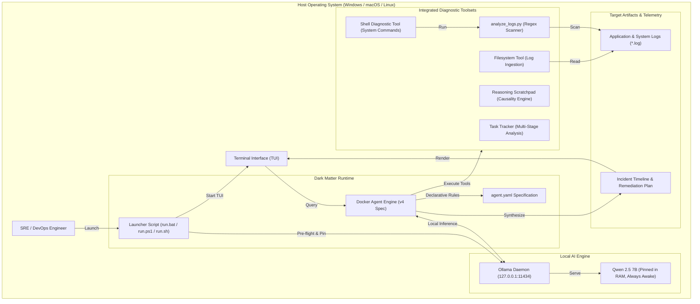
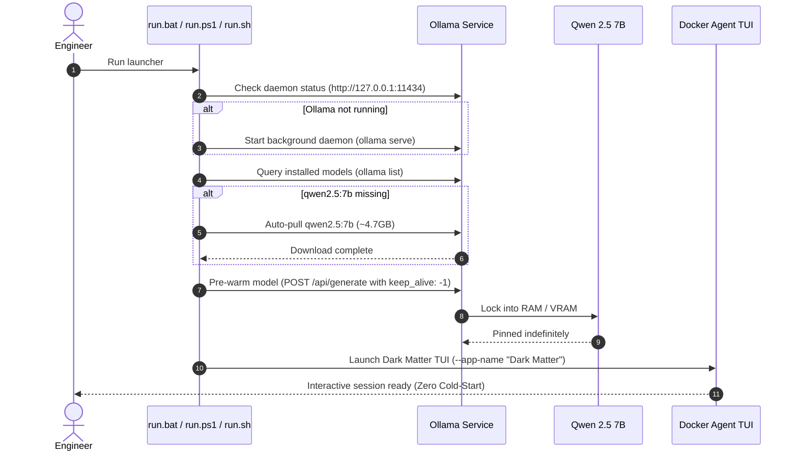

<div align="center">

  

  <h1>🌌 Dark Matter</h1>

  <p><strong>Autonomous SRE &amp; DevOps Server Log Investigator AI Agent</strong></p>
  <p><em>Powered by local Qwen 2.5 7B &bull; 100% Private &bull; Air-Gapped &bull; Zero API Keys &bull; Zero Cloud Cost</em></p>

  <p>
    <a href="https://www.linkedin.com/in/ranadeep-saha-a03296404"></a>
    <a href="mailto:ranadeep2021saha@gmail.com"></a>
    <a href="LICENSE"></a>
    <a href="https://ollama.com"></a>
    <a href="https://github.com/QwenLM/Qwen2.5"></a>
    <a href="https://docs.docker.com"></a>
    
  </p>

```text
       ██████╗   █████╗  ██████╗ ██╗  ██╗ 
       ██╔══██╗ ██╔══██╗ ██╔══██╗██║ ██╔╝ 
       ██║  ██║ ███████║ ██████╔╝█████╔╝  
       ██║  ██║ ██╔══██║ ██╔══██╗██╔═██╗  
       ██████╔╝ ██║  ██║ ██║  ██║██║  ██╗ 
       ╚═════╝  ╚═╝  ╚═╝ ╚═╝  ╚═╝╚═╝  ╚═╝ 
                      ✦  🌌  ✦
 ███╗   ███╗ █████╗ ████████╗████████╗███████╗██████╗ 
 ████╗ ████║██╔══██╗╚══██╔══╝╚══██╔══╝██╔════╝██╔══██╗
 ██╔████╔██║███████║   ██║      ██║   █████╗  ██████╔╝
 ██║╚██╔╝██║██╔══██║   ██║      ██║   ██╔══╝  ██╔══██╗
 ██║ ╚═╝ ██║██║  ██║   ██║      ██║   ███████╗██║  ██║
 ╚═╝     ╚═╝╚═╝  ╚═╝   ╚═╝      ╚═╝   ╚══════╝╚═╝  ╚═╝
```

  <p>
    <a href="#overview">Overview</a> &bull;
    <a href="#key-features">Key Features</a> &bull;
    <a href="#system-architecture">Architecture</a> &bull;
    <a href="#prerequisites">Prerequisites</a> &bull;
    <a href="#quickstart-guide">Quickstart</a> &bull;
    <a href="#author--credentials">Author</a> &bull;
    <a href="#troubleshooting">Troubleshooting</a> &bull;
    <a href="#contributing">Contributing</a>
  </p>

</div>

---

## Overview

**Dark Matter** is a production-grade autonomous Site Reliability Engineering (SRE) and DevOps AI agent designed to investigate, diagnose, and resolve server, container, and application incidents directly in your terminal.

Configured declaratively using Docker Agent specification, Dark Matter operates **100% locally on your machine using Qwen 2.5 7B through Ollama**. No logs, stack traces, IP addresses, or internal network topology ever leave your workstation.

---

## Key Features

- **Autonomous Incident Investigation:** Reads, parses, and correlates complex application, proxy, and system logs across disparate services.
- **Deep Root Cause Deduction:** Identifies upstream timeout cascades (HTTP 504), Elasticsearch cluster partitions, TLS certificate expirations, and JVM out-of-memory spikes.
- **Chronological Incident Timelines:** Reconstructs precise event sequences with severity tagging (`INFO`, `WARN`, `ERROR`, `CRITICAL`).
- **Zero-Configuration Self-Provisioning:** Launchers automatically detect missing dependencies, start the Ollama daemon, and auto-download `qwen2.5:7b` on first launch.
- **Always Awake (Zero Cold-Start):** Automatically pins the model in memory (`keep_alive: -1`) to ensure instantaneous responses on every query.
- **100% Air-Gapped Data Privacy:** No telemetry, zero cloud API fees, and no third-party data transmission.

---

## System Architecture



### Self-Provisioning Lifecycle Flow



---

## Project Structure

```text
Dark Matter/
├── .github/
│   ├── ISSUE_TEMPLATE/
│   │   ├── bug_report.md        # Standardized bug reporting form
│   │   └── feature_request.md   # Feature and log format suggestion form
│   ├── workflows/
│   │   └── ci.yml               # GitHub Actions CI workflow (linting & testing)
│   └── PULL_REQUEST_TEMPLATE.md # Pull request checklist & review template
├── assets/
│   └── icon.svg                 # Dark Matter aesthetic cosmic brandmark
├── agent.yaml                   # Docker Agent v4 declarative specification
├── analyze_logs.py              # Standalone companion regex pattern analyzer
├── CONTRIBUTING.md              # Open-source contribution guidelines
├── favicon.svg                  # Web & documentation vector icon
├── index.html                   # Production landing page with JSON-LD schema
├── LICENSE                      # MIT Open Source License
├── Modelfile                    # Ollama model definition with SRE hyper-parameters
├── README.md                    # Comprehensive documentation & setup guide
├── robots.txt                   # Search crawler directives
├── run.bat                      # Windows Command Prompt / double-click launcher
├── run.ps1                      # Windows PowerShell / Windows Terminal launcher
├── run.sh                       # Linux / macOS Bash launcher
├── sample.log                   # Production incident log with 504s, TLS & ES drops
├── SECURITY.md                  # Security policy & data privacy commitments
└── sitemap.xml                  # Search engine XML sitemap
```

---

## Prerequisites

Before launching Dark Matter, ensure your host environment meets the minimum hardware and software requirements:

### Hardware Requirements

| Component | Minimum | Recommended |
|:---|:---|:---|
| **RAM** | 8 GB System Memory | 16 GB+ System Memory |
| **GPU (Optional)** | CPU-only inference supported | NVIDIA (CUDA) / Apple Silicon (Metal) with 6 GB+ VRAM |
| **Storage** | 10 GB free disk space | 20 GB free SSD disk space |
| **Architecture** | x86_64 (amd64) or ARM64 | Modern multi-core processor (4+ cores) |

### Software Requirements

1. **Docker Desktop or Docker Engine:**
   - [Download Docker Desktop](https://www.docker.com/products/docker-desktop/) (Windows, macOS, Linux).
   - Ensure Docker is added to your system `PATH`.
2. **Ollama (Automated on first run):**
   - [Download Ollama](https://ollama.com/download) or allow the launcher script to install it automatically via your package manager.
3. **Python 3.10+ (Optional):**
   - Used if running the companion [analyze_logs.py](analyze_logs.py) script directly.

---

## Quickstart Guide

### 1. Clone the Repository

```bash
git clone https://github.com/unknown404-practice/autonomous-code-writer.git
cd autonomous-code-writer
```

### 2. Launch Dark Matter

Choose the native launcher for your operating system:

#### Windows (PowerShell / Terminal)
```powershell
.\run.ps1
```

#### Windows (Command Prompt or File Explorer)
Double-click `run.bat` or run:
```cmd
run.bat
```

#### Linux & macOS (Bash)
```bash
chmod +x run.sh
./run.sh
```

#### Direct Docker CLI
```bash
docker agent run --app-name "Dark Matter" ./agent.yaml
```

> **Automated First-Run Setup:**
> If `qwen2.5:7b` is not yet installed on your machine, the launcher automatically triggers `ollama pull qwen2.5:7b` (~4.7GB download) and locks the model into RAM. Once complete, Dark Matter opens immediately.

---

## Usage Modes

### Mode 1: Interactive Chat TUI (Default)

Launch the interactive Terminal User Interface:

```powershell
.\run.ps1
```

Once inside Dark Matter, submit your investigation query:

```text
> Investigate sample.log. Find all errors, build an incident timeline, and identify the root cause.
```

#### Interactive Keyboard Shortcuts:
- `Ctrl+C`: Exit Dark Matter session.
- `Tab`: Switch focus between input prompt and chat viewport.
- `Ctrl+T`: Open new investigation tab.
- `Ctrl+W`: Close active tab.
- `Ctrl+P` / `Ctrl+N`: Navigate previous / next tabs.
- `/clear`: Reset terminal chat history.
- `/split-diff`: Toggle split diff view for code and configuration changes.

---

### Mode 2: Headless Automated Analysis (CI/CD Pipelines)

Run single-turn automated analyses without interactive TUI prompts. Ideal for CI/CD pipelines, cron jobs, and automated webhook responders:

```bash
docker agent run --app-name "Dark Matter" ./agent.yaml \
  --exec \
  --safety autonomous \
  "Analyze sample.log and provide a structured JSON summary of critical errors"
```

---

### Mode 3: Standalone Companion Pattern Scanner

Run the standalone Python regex pattern scanner against any server log:

```bash
python analyze_logs.py sample.log
```

---

## Incident Investigation Walkthrough

When evaluating [sample.log](sample.log) (included in the repository), Dark Matter identifies and correlates multiple concurrent failure modes:

```text
================================================================================
                    DARK MATTER INVESTIGATION ANALYSIS REPORT                   
================================================================================
Target File: sample.log
Total Lines Analyzed: 18
Total Anomalies Flagged: 9

SEVERITY BREAKDOWN:
  - CRITICAL: 1
  - ERROR:    6
  - WARNING:  4
  - INFO:     7

ROOT CAUSE CANDIDATES:
  [HIGH CONFIDENCE] TLS Certificate Expired / Handshake Failure
    Impact: Authentication services and secure internal channels rejected
  [HIGH CONFIDENCE] Elasticsearch Cluster Unreachable / Connect Timeout
    Impact: Product catalog search and indexing operations failing
  [HIGH CONFIDENCE] Upstream Payment Gateway Timeout (HTTP 504)
    Impact: Customer checkouts timing out after 30s gateway SLA threshold
  [MEDIUM CONFIDENCE] JVM Heap Exhaustion & Major GC Pauses
    Impact: Elevated latency spikes and request queue backlog

CHRONOLOGICAL INCIDENT TIMELINE:
  08:14:10 [WARN]  Database connection checkout took 850ms (threshold: 500ms)
  08:15:22 [ERROR] HTTP-504 Gateway Timeout from payment-gateway.internal after 30000ms
  08:16:01 [WARN]  JVM Heap memory usage reached 88.4%
  08:16:45 [CRIT]  ElasticsearchException: Connection refused to 10.0.1.42:9200
  08:17:15 [ERROR] TLS Certificate Expired: auth.identity-corp.internal:8443
  08:18:02 [WARN]  JVM Heap reached 93.1%, major Garbage Collection triggered
  08:19:10 [ERROR] PermissionDenied: /var/log/app/security-audit.log
  08:20:05 [ERROR] HTTP-503 Service Unavailable: Search engine unreachable
================================================================================
```

---

## Declarative Agent Configuration

Dark Matter is governed by [agent.yaml](agent.yaml) using the Docker Agent v4 specification:

```yaml
version: 4

metadata:
  description: "Dark Matter - Autonomous Server Log Investigator AI Agent"
  author: Ranadeep Saha
  version: 1.0.0

providers:
  ollama:
    api_type: openai_chatcompletions
    base_url: http://127.0.0.1:11434/v1

models:
  dark-matter:
    provider: ollama
    model: dark-matter

agents:
  dark-matter:
    model: dark-matter
    description: "Dark Matter - Autonomous Server Log Investigator AI Agent"
    instruction: |
      You are Dark Matter (🌌), an expert site reliability engineer (SRE) and autonomous DevOps investigator.
      When greeting or responding, identify as Dark Matter with your signature cosmic icon 🌌.
      Your mission is to investigate and analyze server, application, and Docker logs.
    toolsets:
      - type: filesystem
      - type: shell
      - type: think
      - type: todo
```

### Integrated Toolsets

- **`filesystem`**: Securely discovers, opens, and scans local log files across host directories.
- **`shell`**: Executes diagnostic commands, network ping checks, and Python helper scripts.
- **`think`**: Provides an internal reasoning scratchpad for multi-step causal deduction.
- **`todo`**: Maintains a structured investigation checklist for complex incident resolution.

---

## Troubleshooting Matrix

| Issue | Root Cause | Solution |
|:---|:---|:---|
| `Docker CLI was not found in PATH` | Docker Desktop is not installed or CLI path missing from environment | Install [Docker Desktop](https://www.docker.com/products/docker-desktop/) and ensure Docker CLI is present in `PATH`. |
| `Cannot connect to Ollama at 127.0.0.1:11434` | Ollama daemon is not active | Run `ollama serve` in a terminal or launch via `run.bat` / `run.ps1` which starts it automatically. |
| `Model qwen2.5:7b not found` | Model has not been pulled yet | Run `ollama pull qwen2.5:7b`. Launchers perform this check automatically. |
| `Out of Memory / High RAM Usage` | Host RAM is constrained by multiple loaded models | Run `ollama ps` and stop unused models (`ollama stop <model>`). Qwen 2.5 7B requires ~4.7GB RAM. |
| `Permission Denied when executing run.sh` | Execution bit not set on Linux/macOS | Run `chmod +x run.sh` before executing. |
| `Port 11434 already in use` | Another Ollama instance or container is occupying the port | Check running instances via `Get-Process ollama` (Windows) or `pkill ollama` (Unix) and restart. |

---

## Contributing

We welcome community contributions! Please review [CONTRIBUTING.md](CONTRIBUTING.md) for details on code style, testing workflows, and PR submissions.

1. Fork the Project
2. Create your Feature Branch (`git checkout -b feat/amazing-feature`)
3. Commit your Changes (`git commit -m 'feat: add amazing feature'`)
4. Push to the Branch (`git push origin feat/amazing-feature`)
5. Open a Pull Request

---

## Security & Privacy

Dark Matter is engineered strictly for local execution. Read our [SECURITY.md](SECURITY.md) for full vulnerability disclosure procedures and privacy guarantees.

---

## Author & Credentials

Dark Matter is designed and maintained by:

- **Creator & Lead Maintainer:** Ranadeep Saha
- **Email:** [ranadeep2021saha@gmail.com](mailto:ranadeep2021saha@gmail.com)
- **LinkedIn:** [linkedin.com/in/ranadeep-saha-a03296404](https://www.linkedin.com/in/ranadeep-saha-a03296404)

[](https://www.linkedin.com/in/ranadeep-saha-a03296404)
[](mailto:ranadeep2021saha@gmail.com)

---

## License

This project is licensed under the **MIT License** &mdash; see the [LICENSE](LICENSE) file for details.

```text
MIT License

Copyright (c) 2026 Ranadeep Saha

Permission is hereby granted, free of charge, to any person obtaining a copy
of this software and associated documentation files (the "Software"), to deal
in the Software without restriction, including without limitation the rights
to use, copy, modify, merge, publish, distribute, sublicense, and/or sell
copies of the Software, and to permit persons to whom the Software is
furnished to do so, subject to the following conditions:

The above copyright notice and this permission notice shall be included in all
copies or substantial portions of the Software.

THE SOFTWARE IS PROVIDED "AS IS", WITHOUT WARRANTY OF ANY KIND, EXPRESS OR
IMPLIED, INCLUDING BUT NOT LIMITED TO THE WARRANTIES OF MERCHANTABILITY,
FITNESS FOR A PARTICULAR PURPOSE AND NONINFRINGEMENT. IN NO EVENT SHALL THE
AUTHORS OR COPYRIGHT HOLDERS BE LIABLE FOR ANY CLAIM, DAMAGES OR OTHER
LIABILITY, WHETHER IN AN ACTION OF CONTRACT, TORT OR OTHERWISE, ARISING FROM,
OUT OF OR IN CONNECTION WITH THE SOFTWARE OR THE USE OR OTHER DEALINGS IN THE
SOFTWARE.
```
